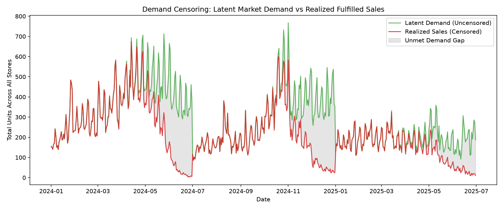
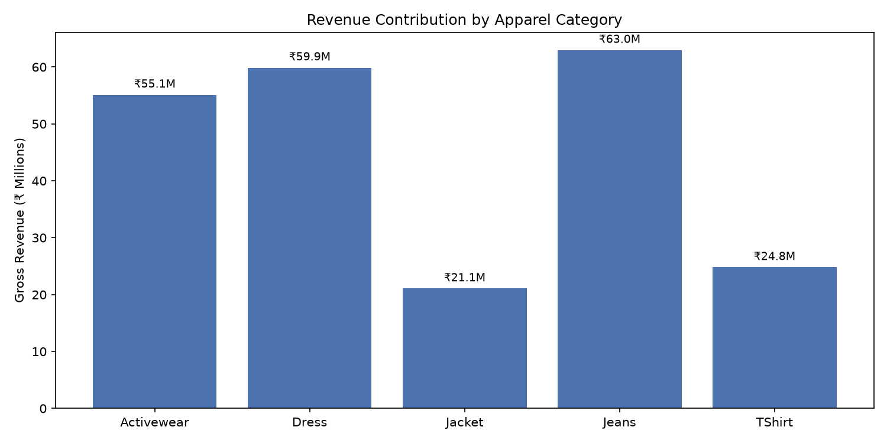
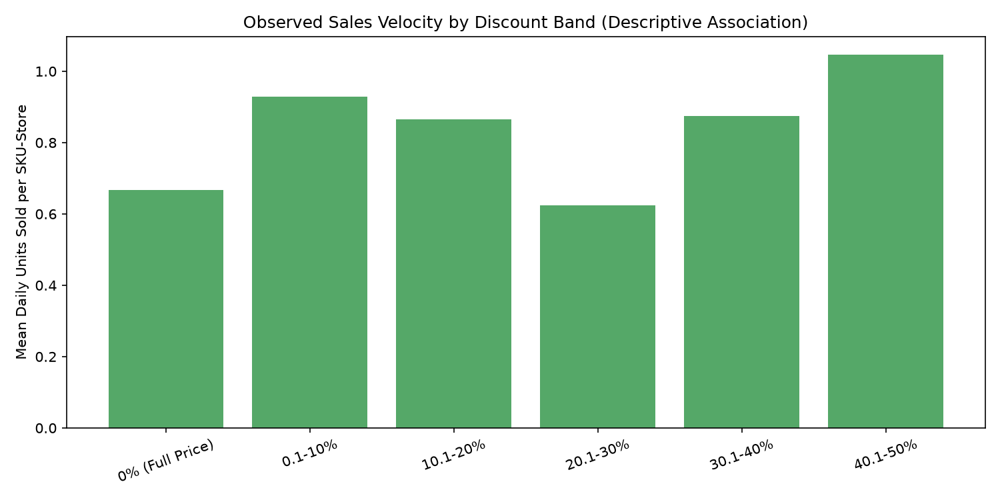
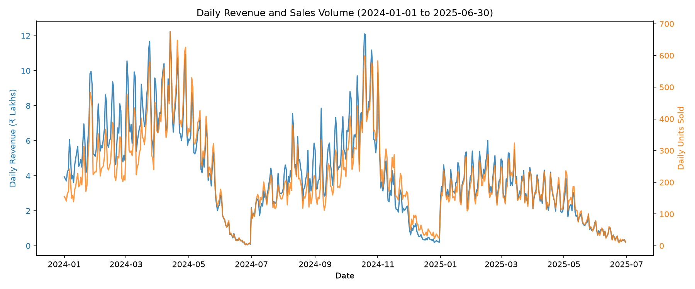

# Exploratory Data Analysis (EDA) Report
**Project:** UC-RT-03 — Markdown Optimization  
**Canonical Dataset:** `data/processed/markdown_optimization_cleaned.csv`  
**Dataset Scale:** 149,270 records | 63 columns | 547 calendar days (2024-01-01 to 2025-06-30)  
**Assortment Scope:** 200 SKUs across 5 retail store locations  

---

## 1. Executive Summary & Core Metrics

| Key Metric | Observed Value | Strategic Context |
| :--- | :--- | :--- |
| **Total Realized Revenue** | **₹223,842,750.00** | Across 5 retail locations in India |
| **Total Units Fulfilled** | **114,668 units** | Net of 9,666 returns (8.43% return rate) |
| **Overall Gross Margin** | **50.76%** | Cost of Goods Sold = ₹110,216,238.00 |
| **Average Discount Depth**| **12.96%** | Ranges from 0% (full price) to 49.99% markdown peak |
| **Stockout Occurrences** | **18,696 events (12.52%)**| Store-days with zero or exhausted stock |
| **Latent Market Demand** | **157,422 units** | True unconstrained customer demand (synthetic benchmark) |
| **Unmet Demand Gap** | **42,754 units (27.16%)**| Unfulfilled customer demand due to stockouts |

---

## 2. Demand Censoring & Stockout Analysis

A critical finding for downstream forecasting and pricing is that **observed sales are heavily censored by inventory stockouts**.

- On **18,696 store-days (12.52%)**, the store ran out of stock (`stockout_flag = 1`).
- During these periods, observed `units_sold` drops to zero or is truncated by whatever residual units remained on hand.
- Synthetic ground truth reveals that customers attempted to purchase **157,422 units**, but only **114,668 units** were sold.
- **Methodological Rule**: Demand forecasting models trained directly on raw `units_sold` will suffer from severe negative bias during high-demand periods unless stockout-censored observations are explicitly accounted for (via hurdle models, Tobit regression, or sample weighting).

---

## 3. Category Dynamics & Elasticity Context

| Category | Gross Revenue (₹) | Units Sold | Avg Price (₹) | Avg Discount | Gross Margin | Lost Demand % | Disc-Vol Corr |
| :--- | :--- | :--- | :--- | :--- | :--- | :--- | :--- |
| **Jeans** | ₹62,969,219 | 29,379 | ₹2,300 | 11.81% | 49.35% | 18.40% | +0.098 |
| **Dress** | ₹59,888,697 | 22,145 | ₹2,930 | 11.23% | 52.05% | 26.33% | **+0.400** |
| **Activewear** | ₹55,111,775 | 29,827 | ₹1,873 | 11.83% | 54.13% | 25.52% | +0.243 |
| **T-Shirt** | ₹24,803,687 | 27,340 | ₹914 | 11.49% | **57.33%** | 25.69% | **-0.014** |
| **Jacket** | ₹21,069,372 | 5,977 | ₹3,916 | **23.48%** | **34.77%** | **58.83%** | +0.311 |

### Key Category Takeaways:
1. **Dresses** demonstrate the strongest observed volume responsiveness to discounts (correlation +0.400).
2. **Jackets** suffer from severe end-of-season liquidation distress: lowest margin (34.77%), highest discount depth (23.48%), and highest unmet demand (58.83%), reflecting late clearance actions on depleted inventory.
3. **T-Shirts** act as staple, price-inelastic essentials with strong gross margins (57.33%). Price cuts yield virtually no volume expansion.

---

## 4. Store Performance & Network Variations

| Store ID | Location | Store Type | Revenue (₹) | Units Sold | Stockout Rate % | Lost Demand % |
| :--- | :--- | :--- | :--- | :--- | :--- | :--- |
| **STORE-01** | Mumbai | Flagship | ₹64,589,117 | 32,726 | 13.89% | 24.60% |
| **STORE-03** | Bengaluru | High Street | ₹49,423,736 | 25,076 | 12.27% | 24.84% |
| **STORE-02** | Delhi | Mall | ₹47,621,951 | 23,370 | 12.20% | 28.25% |
| **STORE-04** | Hyderabad | Outlet | ₹32,300,909 | 18,661 | **14.92%** | **34.50%** |
| **STORE-05** | Kolkata | High Street | ₹29,907,037 | 14,835 | **9.43%** | 24.29% |

- **STORE-04 (Hyderabad Outlet)** exhibits the highest stockout frequency (14.92%) and largest proportion of lost demand (34.50%). As an outlet location, aggressive markdowns paired with inadequate replenishment resulted in high lost revenue.
- **STORE-05 (Kolkata)** maintained the strictest inventory availability (stockout rate under 9.5%).

---

## 5. Discount Bands & Promotional Impact

| Discount Band | Record Days | Mean Daily Units / SKU | Total Revenue (₹) | Stockout Rate % |
| :--- | :--- | :--- | :--- | :--- |
| **0% (Full Price)** | 79,010 | 0.668 units | ₹115,835,858 | 6.16% |
| **0.1 - 10%** | 7,690 | 0.930 units | ₹17,112,112 | 4.77% |
| **10.1 - 20%** | 16,770 | 0.865 units | ₹23,769,314 | 12.15% |
| **20.1 - 30%** | 14,667 | 0.624 units | ₹17,909,229 | 19.41% |
| **30.1 - 40%** | 8,443 | 0.874 units | ₹12,213,148 | 23.98% |
| **40.1 - 50%** | 22,690 | 1.046 units | ₹37,003,089 | 28.88% |

> [!WARNING]
> **Causal Interpretation Warning**: The monotonic increase in sales velocity across discount bands represents descriptive historical association, **not unconfounded causal price elasticity**. Markdowns in this dataset correlate with clearance phases, seasonal aging, and promotional calendar events. Causal estimation in Phase 3 requires controlling for lifecycle stage, baseline velocity, and seasonality.

---

## 6. Seasonality & Daily Sales Trends

- Daily retail sales display strong weekly seasonality (spikes on weekends and public holidays).
- The transition from `REGULAR_SEASON` into `END_OF_SEASON` and `CLEARANCE` shows a structural divergence between unit volume (sustained by markdowns) and average realized selling price.

---

## 7. Implications for Downstream Modeling (Phase 3)

1. **Target Construction**: Operational forecast target should be `units_sold` with an explicit sample weight or indicator for `stockout_flag == 0`.
2. **Lagged Features**: Build strictly causal $T-1$, $T-7$, and $T-14$ rolling demand features.
3. **Censoring Flag**: Retain `stockout_flag` as a downstream loss mask.
4. **Leakage Guardrails**: Ground truth `benchmark_latent_demand_units` must remain strictly quarantined for offline model benchmarking.
