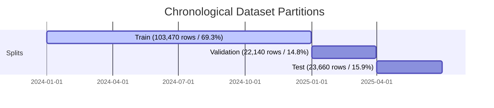

# Feature Engineering & Chronological Splitting Report
**Project:** UC-RT-03 — Markdown Optimization  
**Cutoff Definition:** Store opening on Day T, strictly before any customer sales or transactions occur  
**Input Data:** `data/processed/markdown_optimization_cleaned.csv` (149,270 rows)  
**Output Files:**  
- Full Feature Table: `data/processed/markdown_features_canonical.csv` (149,270 rows, 69 cols)  
- Train Partition: `data/processed/train.csv` (103,470 rows, 69.32%)  
- Validation Partition: `data/processed/validation.csv` (22,140 rows, 14.83%)  
- Test Partition: `data/processed/test.csv` (23,660 rows, 15.85%)  

---

## 1. Forecast Cutoff & Causal Timing Contract

Every predictor feature is verified to be available at or before store opening on Day T:
- **Opening Inventory State**: `opening_stock_units` represents on-hand stock position at store opening of Day T, which mathematically equals `on_hand_units[T-1]`.
- **Planned Pricing & Promotions**: Price events are approved $\ge 6$ hours in advance; promotional calendars are planned.
- **Weather & Competitor Signals**: Observed at $T-1$ evening between 17:22 and 22:57.
- **Calendar & Assortment Lifecycle**: Deterministic calendar properties and static catalog metadata.
- **Entity Lags**: Historical sales and stockout flags shifted by $\ge 1$ day per `(store_id, sku_id)` pair.

---

## 2. Leakage Controls & Prohibited Columns

The following columns from operational data are **strictly prohibited** from the predictor feature set:
1. `units_sold`: Target outcome for day $T$.
2. `revenue`: Derived post-hoc outcome ($units \times price$).
3. `returns_units`: Realized intraday return outcomes.
4. `stockout_flag`: Realized outcome of inventory exhaustion (retained only as `target_stockout_mask` for loss masking).
5. `on_hand_units`, `available_units`: Closing inventory after day $T$ customer traffic.
6. `intraday_units_received`, `intraday_units_dispatched`, `intraday_shrinkage_units`: Intraday operational flows.
7. `benchmark_latent_demand_units`: Synthetic unconstrained customer demand (isolated exclusively as `eval_benchmark_latent_demand`).

---

## 3. Engineered Feature Taxonomy

| Feature Category | Features Included | Causal Rationale |
| :--- | :--- | :--- |
| **Sales Velocity Lags** | `sales_lag_1d`, `sales_lag_2d`, `sales_lag_7d`, `sales_lag_14d` | Captures recent short-term and weekly seasonal demand momentum. |
| **Rolling Sales Statistics**| `sales_rolling_mean_7d`, `sales_rolling_std_7d`, `sales_rolling_mean_14d`, `sales_rolling_mean_28d` | Baseline sales rate and demand volatility over past 1 to 4 weeks. |
| **Historical Stockout Pressure** | `stockout_lag_1d`, `stockout_rolling_sum_7d`, `stockout_rolling_sum_14d` | Quantifies chronic supply depletion and unfulfilled demand pressure. |
| **Inventory Health** | `inventory_runout_days`, `inventory_to_capacity_ratio` | Days of supply remaining before stockout based on recent 7-day velocity. |
| **Pricing Ratios** | `price_ratio_to_regular`, `price_ratio_to_cost`, `planned_margin_pct`, `price_difference_to_competitor` | Relative price positioning and margin buffers for day $T$. |
| **Lifecycle Progression** | `season_completion_pct` | Progression through seasonal life cycle towards markdown clearance. |

---

## 4. Chronological Split Details

- **Temporal Disjointness**: Zero temporal overlap between Train, Validation, and Test partitions.
- **Assortment Continuity**: Rolling features for early January 2025 carry continuous past lag state from late 2024 across entity histories without artificial resets.
- **Untouched Final Test**: The test set covers the final spring/summer season of 2025, completely isolated until final evaluation.
